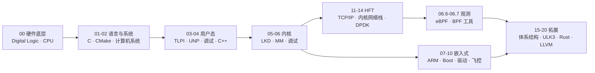

<!-- Animated Typing Header -->
<picture>
  <source media="(prefers-color-scheme: dark)" srcset="https://readme-typing-svg.herokuapp.com?lines=HFT+Systems+Engineer;Low-Latency+Trading+Infrastructure;Linux+Kernel+Internals;eBPF+%2B+DPDK+%2B+Rust&center=true&font=Fira+Code&weight=700&color=F0CD46&size=24&pause=1000&width=560&height=120">
  <source media="(prefers-color-scheme: light)" srcset="https://readme-typing-svg.herokuapp.com?lines=HFT+Systems+Engineer;Low-Latency+Trading+Infrastructure;Linux+Kernel+Internals;eBPF+%2B+DPDK+%2B+Rust&center=true&font=Fira+Code&weight=700&color=B8860B&size=24&pause=1000&width=560&height=120">
  
</picture>

 

---

### About

I build **ultra-low-latency trading systems** for high-frequency quantitative trading. My work lives at the intersection of **systems programming**, **kernel-level optimization**, and **quantitative finance**.

从事高频量化交易领域的低延迟系统开发，工作重心落在**系统编程**、**内核级优化**与**量化金融**的交叉地带。

| | |
|:---|:---|
| **Core Focus** | HFT low-latency engineering — kernel tuning, CPU pinning, cache-line optimization |
| **Active Research** | Linux kernel internals · eBPF/BPF observability · DPDK/AF_XDP · lock-free data structures |
| **Primary Stack** | Rust · C · C++ |
| **Method** | Systematic documentation — structured notes, kernel source analysis, hands-on lab records |
| **Direction** | 持续夯实系统能力，目标是 Rust 开源上游贡献 |
| **Contact** | 📮 [1239263644@qq.com](mailto:1239263644@qq.com) |

---

### Now · 进行中

> 每条都是仓库里能翻到对应产出的实线，不是愿望清单。

- 📖 **TLPI 全 64 章**逐节精读笔记 — 持续产出，优先 HFT/嵌入式高价值章节
- 🧠 **LKD3rd 对照主线** — 20 章 151 篇，配合 5.x/6.x 内核源码逐机制核对
- ⚙️ **STM32 + RTOS** — 寄存器级裸机 → FreeRTOS → Zephyr，坚持 clang + lld 工具链
- 🔍 **eBPF** — Raspberry Pi 5 实验平台，bpftrace / libbpf / ring buffer labs
- 🦀 **Rust** — 基础 → 量化 → 无锁并发，目标上游贡献

---

### Tech Stack

<table>
<tr>
<td align="center" valign="top" width="33%">

**Languages**

</td>
<td align="center" valign="top" width="33%">

**Systems & Tools**

</td>
<td align="center" valign="top" width="33%">

**Domains**

</td>
</tr>
</table>

---

### Flagship Project

[**hft-embedded-linux-study**](https://github.com/cshonor/hft-embedded-linux-study) &nbsp;—&nbsp; **34 modules** · **8,000+ notes** · HFT low-latency + embedded Linux

> **递进主轴：** 硬件底层 → 编程语言 → Linux 系统 → 驱动/设备树 → 嵌入式工程 → 网络栈 → 性能工具 → HFT 上层业务

`00`–`20` 编号即学习顺序，`.5` / `.6` / `.7` 不是子模块，而是**现代补丁层**——经典书基于 2.6/3.x 内核，这些模块补齐 5.x/6.x 的真实实现（bootmem→memblock、SLAB→SLUB、LRU→MGLRU、page→folio）。

**动手线 L0 → L5**（项目本身就是路径，不是读完书再做）：

| 级 | 交付项目 | 硬验收指标 |
|:--:|----------|------------|
| **L0** | 自实现 `malloc` + 对齐/合并 benchmark | 能解释 chunk header / bins / `M_MMAP_THRESHOLD` |
| **L1** | 多线程 TCP echo server（epoll ET + 线程池） | p99 < 200μs，能画出请求完整路径 |
| **L2** | `perf` 定位并消除一次真实抖动 | 火焰图 + `perf stat` 说清瓶颈归属 |
| **L3** | UDP 组播行情接收器（含丢包统计） | 10 万 pps 下**零丢包**，能说出丢在哪一层 |
| **L4** | SPSC 无锁 ring（padding 前后对比） | 单跳 < 100ns，p99 < 200ns，批量消费版更快 |
| **L5** | 三进程 FeedHandler → Book → Strategy | 软件栈 tick-to-trade **p99 < 10μs**（自测环境如实记录） |

> **调试与开发同权重**：右列那些指标不是靠感觉判断的，只能靠工具测出来。三层顺序固定——先让它对（gdb/strace/ASan/KASAN），再让它快（perf/eBPF），最后让它可观测（bpftrace + BPF 工具谱系）。
> **ARM64 汇编在 L4 第一次变现**：x86 是 TSO 强序，`acquire/release` 编译成零指令——「忘了写 `memory_order`」在 x86 上常常碰巧能跑；ARM64 弱序，`ldar`/`stlr` 少一条就直接崩。

[在线阅读](https://cshonor.github.io/hft-embedded-linux-study/) · [模块总览 · 学习路线 · 全部交付项目](https://github.com/cshonor/hft-embedded-linux-study#模块总览编号--学习顺序)

---

### Selected Repositories

| Repository | Stars | What it covers |
|:---|:---:|:---|
| [hft-embedded-linux-study](https://github.com/cshonor/hft-embedded-linux-study) | 11 | 主线仓库：HFT 低延迟 + 内核/MM/并发 + 嵌入式飞控双线笔记 |
| [golang-gate](https://github.com/cshonor/golang-gate) | 8 | Go 后端系统进阶：语法、并发、内存、网络底层原理 |
| [Quant-AI-Foundations](https://github.com/cshonor/Quant-AI-Foundations) | 7 | 多因子量化 / 智能体开发 / 期权期货随机金融的数学与 CS 基座 |
| [Computer-Networking](https://github.com/cshonor/Computer-Networking) | 6 | 网络原理、Socket 编程、TCP/IP 底层、服务端网络问题排查 |
| [stm32-rtos](https://github.com/cshonor/stm32-rtos) | 3 | STM32 + RTOS 嵌入式开发：寄存器级裸机 → FreeRTOS → Zephyr |
| [cpp-learning-notes](https://github.com/cshonor/cpp-learning-notes) | 3 | C / C++ 基础与进阶，配套可运行代码 |
| [LDD-](https://github.com/cshonor/LDD-) | 1 | Linux 内核模块与设备驱动开发 |
| [ebpf-gate](https://github.com/cshonor/ebpf-gate) | 1 | eBPF / libbpf / bpftrace 观测实验 |

---

### Learning Roadmap

<b>模块总览（编号 = 学习顺序）</b>

| Phase | 模块 | Key Topics |
|:-----:|:-------|:-----------|
| **1** | `00` | 数字逻辑与 CPU：组合/时序电路、CPU 词汇 |
| **2** | `01` `01.5` `01.7` `01.8` `02` | C 语言与指针 · CMake 构建 · 三平台工具链互译 · Shell/Bash · 程序=机器（栈/缓存/VM/并发） |
| **3** | `03` `03.5` `03.6` `04` | TLPI 用户态系统编程 · UNP Socket API · gdb/strace/ASan/TSan · Modern C++ |
| **4** | `05` `05.5` `05.6` `06` `06.5` | LKD 内核入门 · 现代内核非 MM · KASAN/KGDB/Ftrace · Gorman MM · SLUB/MGLRU/DAMON |
| **5A** | `07` `08` `09` `10` | ARM/AArch64 · U-Boot/内核构建/rootfs · 驱动与设备树 · PID/姿态/飞控 |
| **5B** | `11` `11.5` `12` `12.5` `13` `14` | Stevens TCP/IP · Wireshark 抓包实战 · Rosen 内核网络栈 · XDP/io_uring · DPDK/AF_XDP · HFT 工程 |
| **5B** | `06.6` `06.6.5` `06.7` | eBPF 原理（Liz Rice）· 系统性能方法论（Gregg）· BPF 性能工具（Gregg） |
| **6** | `15` `16` `17` `18` `19` `20` | 体系结构加深 · ULK3 内核深度 · Rust 基础 · Rust 量化 · 市场微观结构 · LLVM 编译器 |

---

### GitHub Stats

<picture>
  <source media="(prefers-color-scheme: dark)" srcset="https://github-readme-stats.vercel.app/api?username=cshonor&show_icons=true&theme=dark&hide_border=true&bg_color=0D1117&title_color=F0CD46&icon_color=F0CD46&text_color=C9D1D9&ring_color=F0CD46">
  <source media="(prefers-color-scheme: light)" srcset="https://github-readme-stats.vercel.app/api?username=cshonor&show_icons=true&theme=light&hide_border=true&bg_color=FFFFFF&title_color=B8860B&icon_color=B8860B&text_color=333333&ring_color=B8860B">
  
</picture>

&nbsp;

<picture>
  <source media="(prefers-color-scheme: dark)" srcset="https://github-readme-stats.vercel.app/api/top-langs/?username=cshonor&layout=compact&theme=dark&hide_border=true&bg_color=0D1117&title_color=F0CD46&text_color=C9D1D9">
  <source media="(prefers-color-scheme: light)" srcset="https://github-readme-stats.vercel.app/api/top-langs/?username=cshonor&layout=compact&theme=light&hide_border=true&bg_color=FFFFFF&title_color=B8860B&text_color=333333">
  
</picture>

&nbsp;

<picture>
  <source media="(prefers-color-scheme: dark)" srcset="https://streak-stats.demolab.com/?user=cshonor&theme=dark&hide_border=true&background=0D1117&ring=F0CD46&fire=F0CD46&currStreakLabel=F0CD46&sideLabels=C9D1D9&dates=C9D1D9&currStreakNum=C9D1D9">
  <source media="(prefers-color-scheme: light)" srcset="https://streak-stats.demolab.com/?user=cshonor&theme=light&hide_border=true&background=FFFFFF&ring=B8860B&fire=B8860B&currStreakLabel=B8860B&sideLabels=333333&dates=333333&currStreakNum=333333">
  
</picture>

---

📮 **Contact** · [1239263644@qq.com](mailto:1239263644@qq.com) · [GitHub @cshonor](https://github.com/cshonor)

**保持思考，坚持编码，沿着既定路线稳步精进。**

*Keep thinking, keep coding — steady progress along a planned path.*

